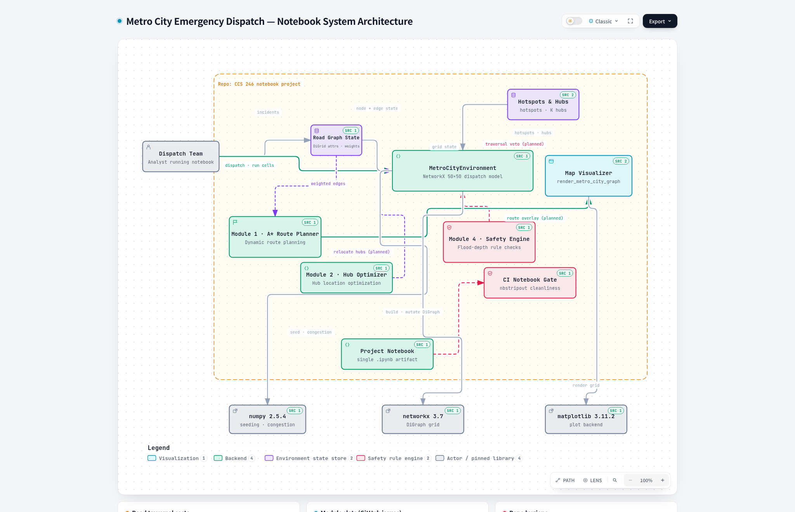

# Setup environment (collaborators)
IMPORTANT: It is highly recommended to create a python venv before installing dependencies as to keep your global python environment clean.

To create and activate venv:
1. Windows:
```bash
python -m venv .venv 
.venv\Scripts\Activate
```
2. macOS / Linux
```bash
python3 -m venv .venv
source .venv/bin/activate
```

After cloning, run the commands:
```bash
pip install -r requirements.txt # make sure your venv is enabled if opting to work in venv
nbstripout --install && git config filter.nbstripout.extrakeys "metadata.kernelspec metadata.language_info"
```

The last two commands make sure jupyter notebook metadata changes are not included in commits and cause issues.
## Architecture

Static preview of the notebook-system architecture (dark/light themes, zoom, export buttons available in the interactive version):



- Interactive explorable diagram: [docs/architecture/metro-city-system.html](docs/architecture/metro-city-system.html) — GitHub's file view shows its source, so open it locally (`open docs/architecture/metro-city-system.html`) for the real interactive canvas.
- Once GitHub Pages is enabled (source: `main` → `/docs` folder), the interactive diagram is reachable at: https://renz0826.github.io/Autonomous-Urban-Emergency-Dispatch-Routing-System/architecture/metro-city-system.html
